# Cairn · Governed Agentic E-Commerce Platform


**An enterprise-grade agentic e-commerce platform where autonomous AI shopping delegation is strictly governed by deterministic rule engines, client-signed constraints, cryptographic state verification, and human-in-the-loop safeguards.**

[](https://github.com/Mohnish-140605/agentic_governance_ecommerce)
[-brightgreen?style=flat&logo=pytest&logoColor=white)](https://github.com/Mohnish-140605/agentic_governance_ecommerce)
[](https://fastapi.tiangolo.com/)
[](https://react.dev/)
[](https://vitejs.dev/)
[](https://www.python.org/)
[](https://oxc.rs/)
[](#architecture--governance-pipeline)
[](#design-principles)
[](LICENSE)

[Visual Tour & App Screenshots](#-visual-tour--application-screenshots) • [System Architecture](#-system-architecture) • [Key Capabilities](#-key-capabilities) • [Empirical Results & Telemetry](#-empirical-results--telemetry) • [Quick Start](#-quick-start-guide) • [Engineering Audit & Scope](#-engineering-audit--honesty-declaration)

</div>

---

## 📸 Visual Tour & Application Screenshots

The high-resolution captures below document the live dual-portal implementation of **Cairn**, highlighting its end-to-end shopping journey, multi-agent negotiation, deterministic safeguards, and merchant operations. All captures are maintained in the [`screenshot_of_app/`](screenshot_of_app/) directory.

---

### Phase 1: Portal Gate & Secure Authentication

Separates the consumer shopping experience from merchant operations with strict credential isolation, role guards, and modern authentication methods (Google OAuth, WebAuthn passkeys, and sandboxed demo modes).

| Screen | Description & Governance Role |
|---|---|
| **1. Dual-Persona Role Gateway**<br>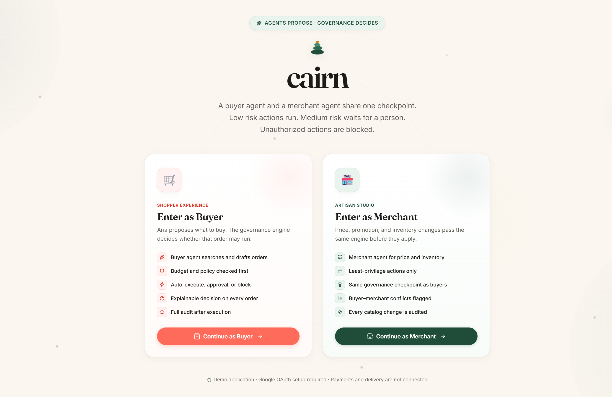 | **Portal Separation Checkpoint**: High-level gateway routing users to either the Buyer Experience (Aria AI) or Merchant Studio with zero session bleed. |
| **2. Buyer Multi-Factor Authentication**<br>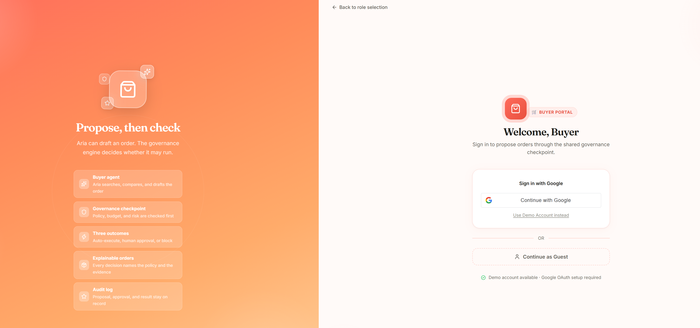 | **Identity Access Management**: Offers Google OAuth 2.0, biometric passkey / WebAuthn authentication, and local sandbox demo profiles. |
| **3. Google Identity Services (GIS)**<br>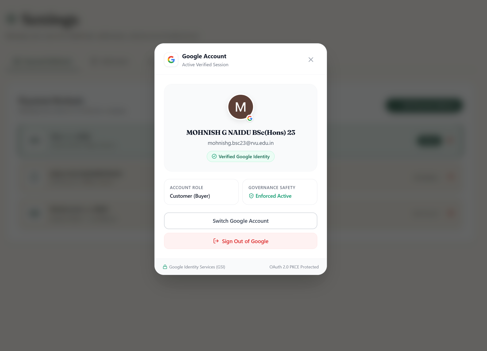 | **Direct OAuth Integration**: Standard GIS pop-up credential federator linking verified profile data directly to buyer policy state. |

---

### Phase 2: Ambient Intent & Conversational Agent (`Aria`)

Aria acts as a personal shopping agent that understands conversational nuances, searches catalogs, and structures proposals—while being strictly quarantined from financial settlement.

| Screen | Description & Governance Role |
|---|---|
| **4. Buyer Explore & Catalog**<br>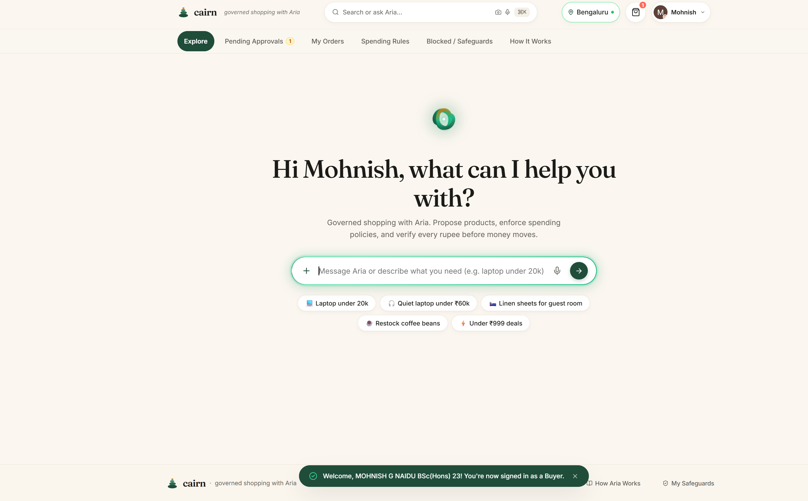 | **Ambient Product Discovery**: Natural language prompt input, suggested search queries, and curated slow-living catalog with real-time stock indicators. |
| **5. Governed Agentic Chat**<br>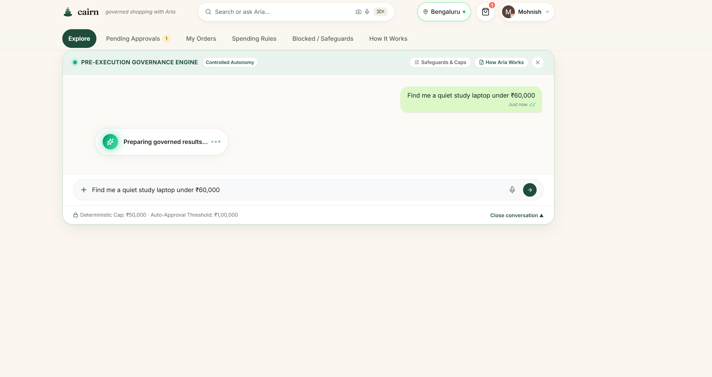 | **Quarantined Intent Parsing**: Conversational UI where Aria extracts specifications and checks candidate items against pre-set client policies before proposing. |
| **6. Multi-Agent Proposal Card**<br>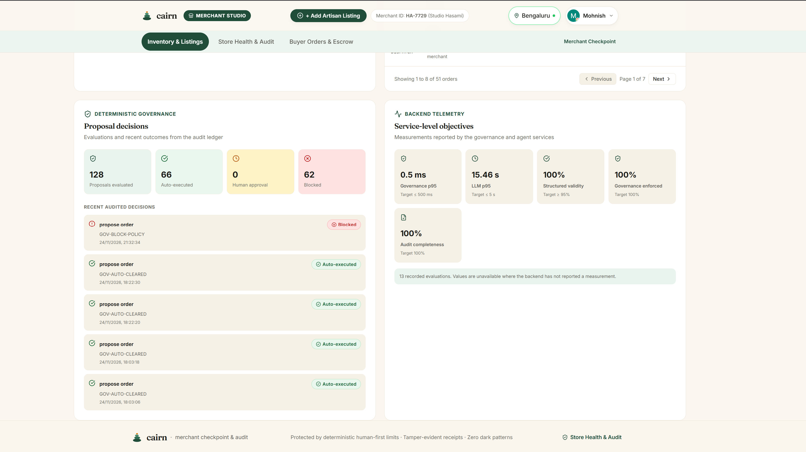 | **Autonomous Proposal Breakdown**: Rich interactive recommendation cards detailing price, specifications, acoustics, and governance clearance status. |

---

### Phase 3: Deterministic Safeguards & Order Settlement

Where probabilistic AI ends and hard deterministic code takes over. No purchase is executed without passing policy limits, risk scoring, and human authorization.

| Screen | Description & Governance Role |
|---|---|
| **7. "Needs-OK" Interactive Pre-Approval**<br>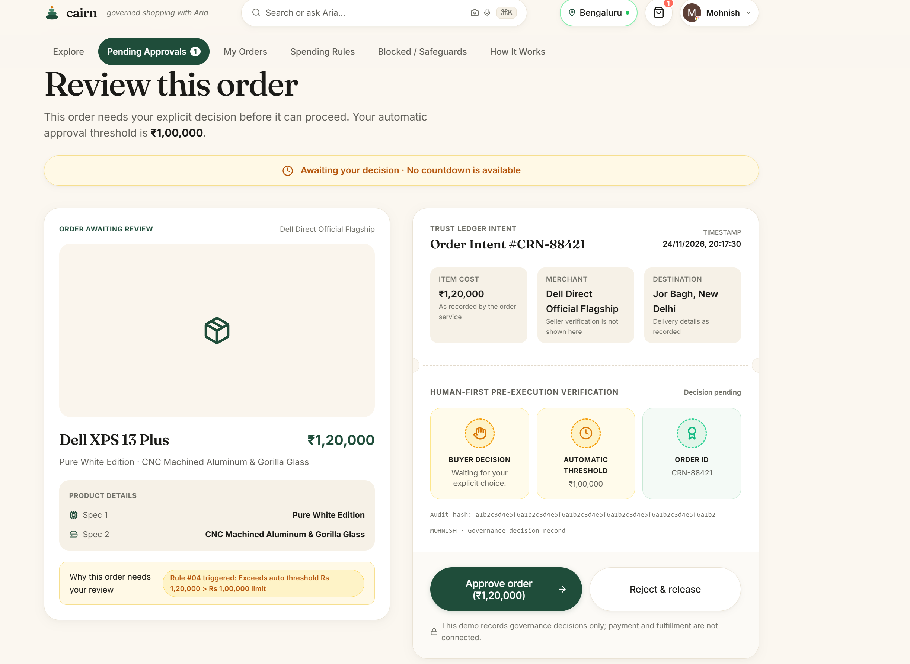 | **Human-in-the-Loop Buffer**: Triggered automatically when an order exceeds the auto-approval threshold. Features an interactive approval slider and 15-min tranquility hold. |
| **8. Rule Breach Interception & Alternatives**<br>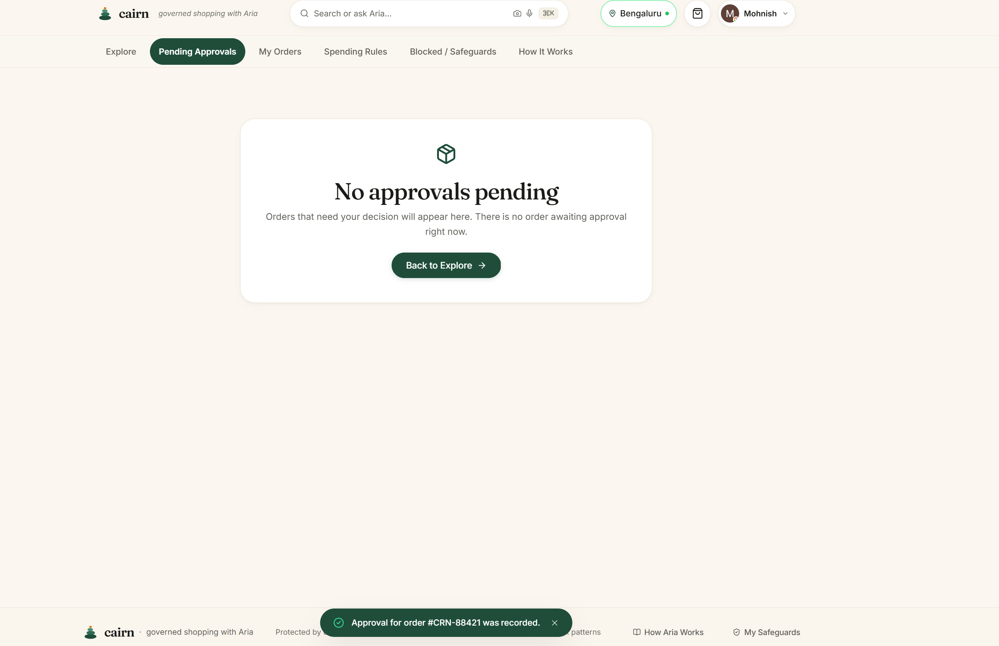 | **Graceful Auto-Rejection**: When an item violates budget ceilings, Aria blocks execution, displays human-readable reasons, and suggests within-budget alternatives. |
| **9. Deterministic Order Execution**<br>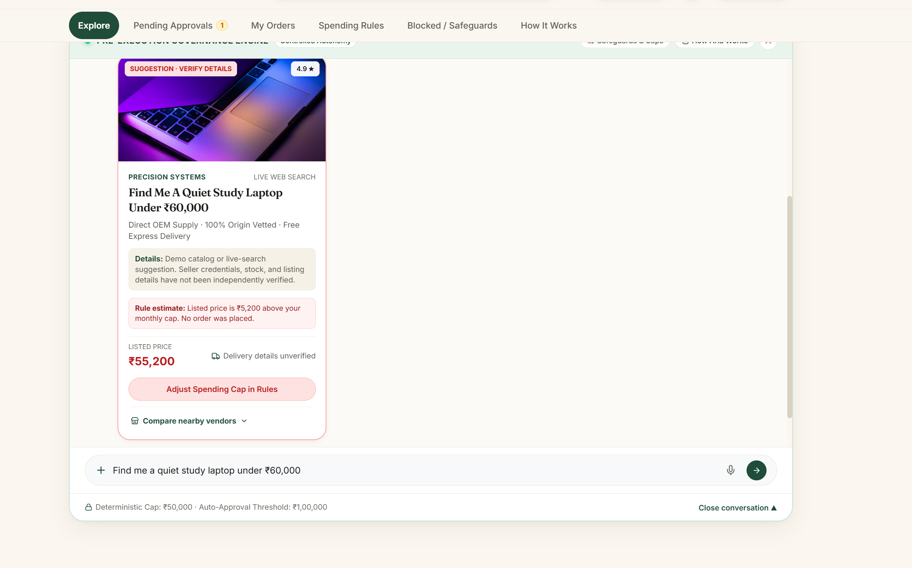 | **Cryptographic Settlement**: Direct checkout produces an immutable 3-Stamp Trust Receipt with SHA-256 state hashing and verified vendor routing. |
| **10. Buyer Order History & Tranquility Hold**<br>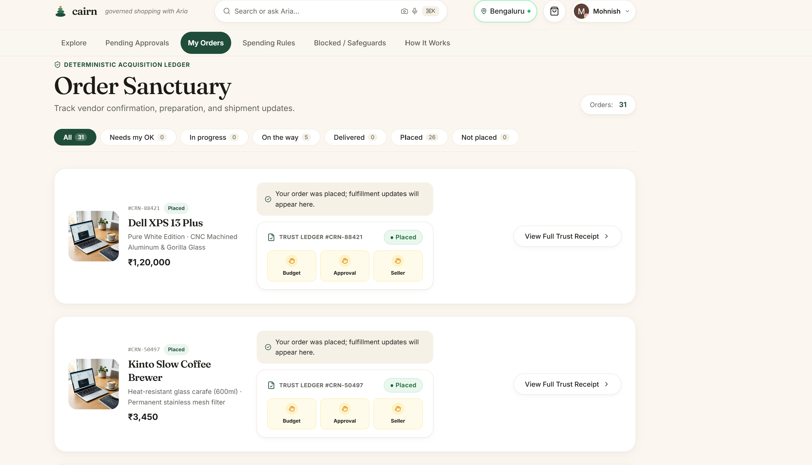 | **Live Tracking & 1-Click Cancel**: Tracks active orders with real-time tranquility countdowns, tracking references, and zero-fee cancellation release. |

---

### Phase 4: Buyer Policy Tuning & Governance Rules

Buyers retain complete agency over their AI delegate through transparent, granular policy controls.

| Screen | Description & Governance Role |
|---|---|
| **11. Buyer Settings & Preferences**<br>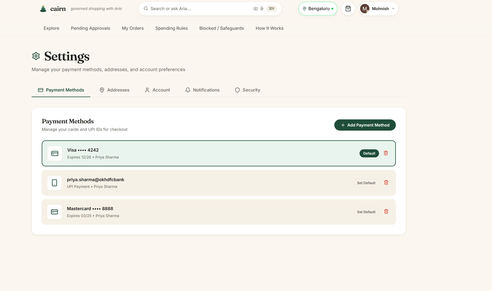 | **Personal Configuration**: Delivery addresses, notification sound toggles (browser audio-gesture compliant), and session preferences. |
| **12. Spending Safeguards Control Center**<br>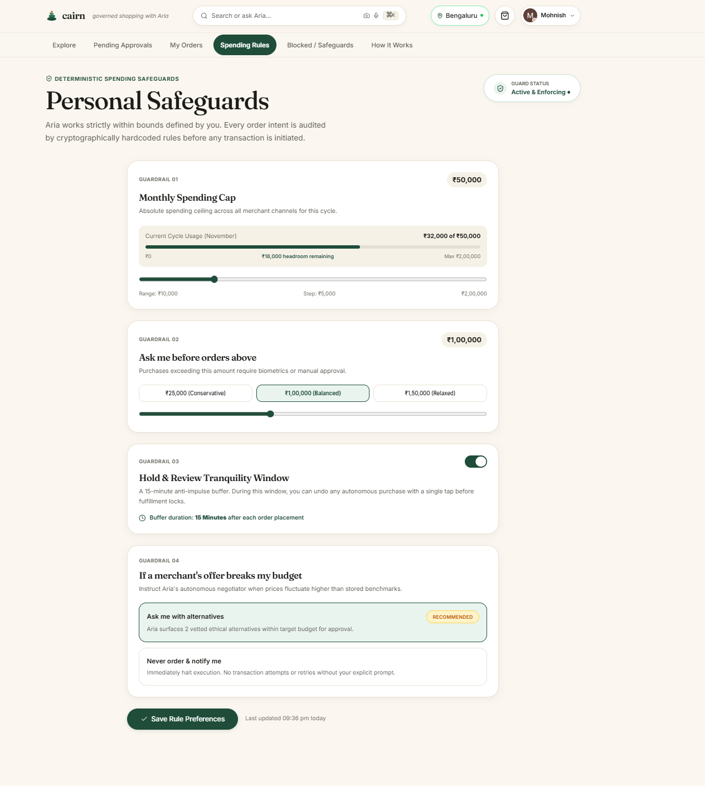 | **Deterministic Rule Sandbox**: Set monthly spending ceilings, single-order auto-approval thresholds, tranquility durations, and price-surge policies. |

---

### Phase 5: Merchant Studio & Operational Governance

A dedicated portal for artisan partners and OEM merchants to manage catalogs, fulfill orders, review escrow settlements, and monitor store compliance.

| Screen | Description & Governance Role |
|---|---|
| **13. Merchant Studio Authentication**<br>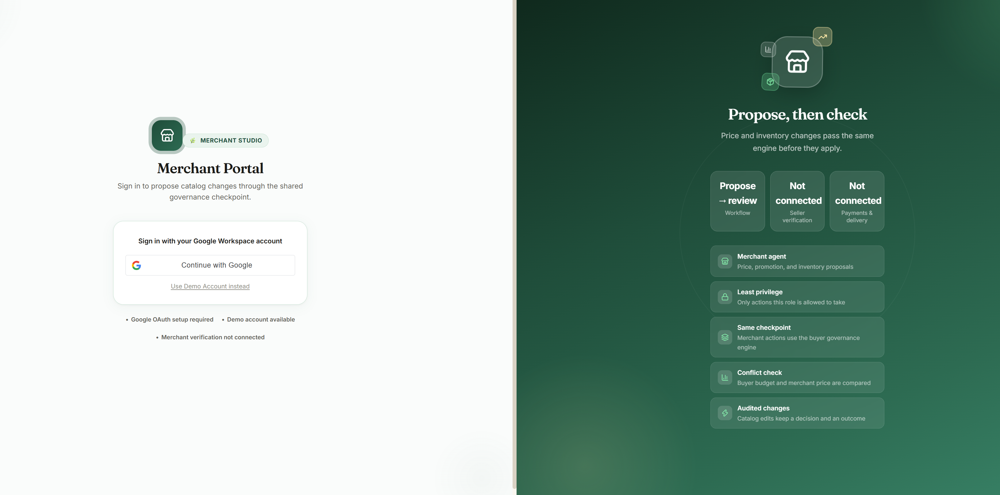 | **Vendor Access Gate**: Authenticated login for store managers with persistent vendor identity. |
| **14. Merchant Operational Dashboard**<br>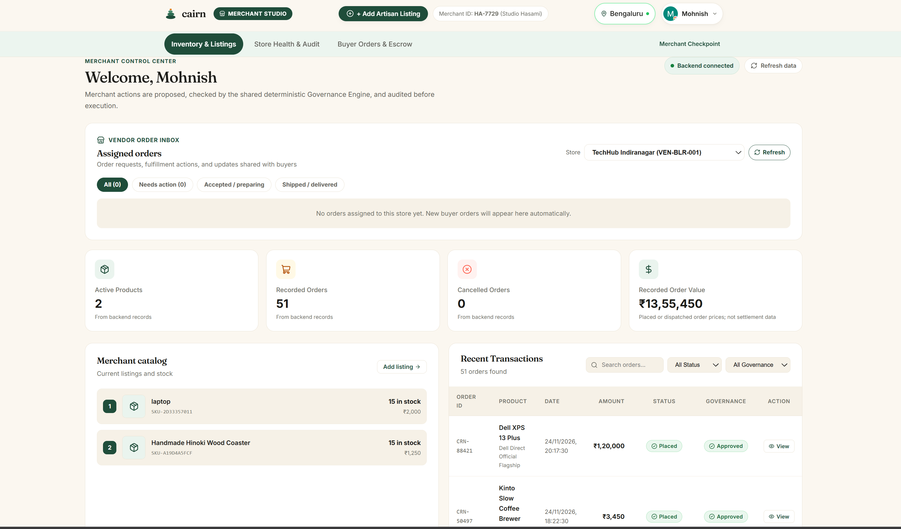 | **Command Center**: Real-time sales telemetry, active inventory status, incoming orders stream, and PDF catalog ingestion status. |
| **15. Merchant Order Processing Pipeline**<br>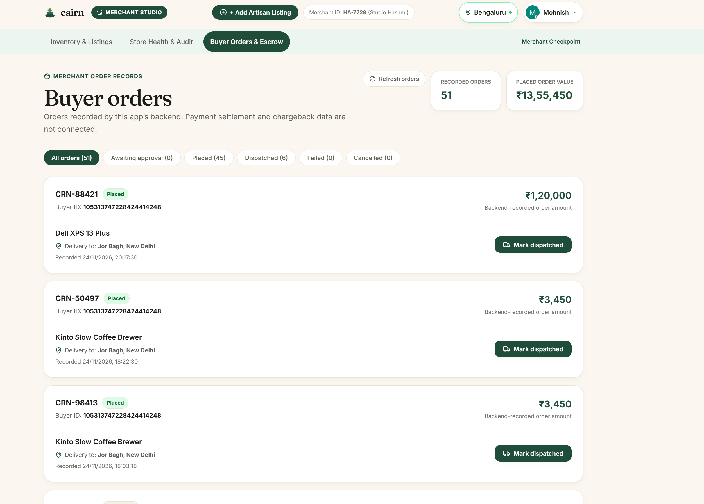 | **Lifecycle Management**: View allocated orders, accept/prepare requests, review customer fulfillment deadlines, and handle reassignments. |
| **16. Settlement Escrow & Recent Transactions**<br>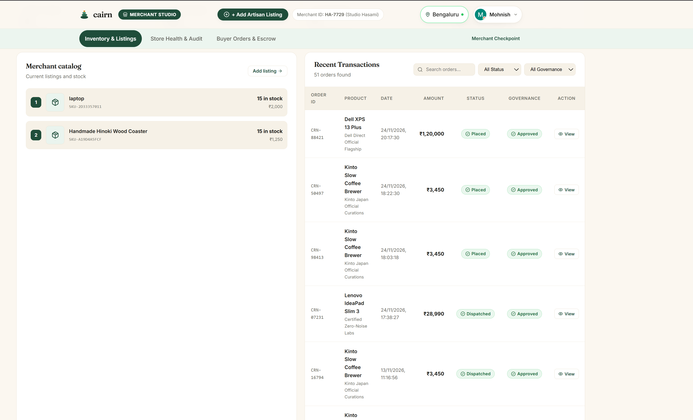 | **Cryptographic Ledger**: Detailed settlement log displaying release times, payment escrow states, and canonical transaction hashes. |
| **17. Order Dispatch & Fulfillment Tracking**<br>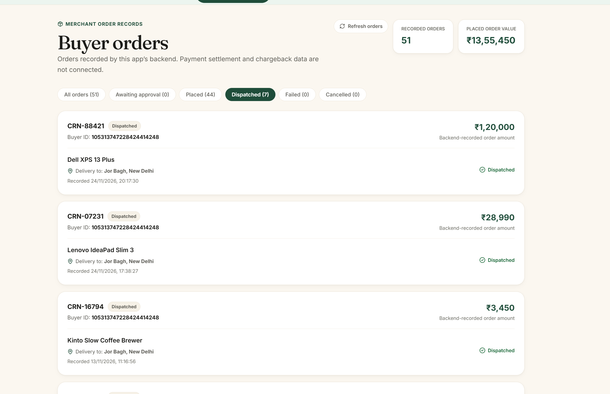 | **Carrier Verification**: Dispatch modal requiring carrier assignment and tracking reference, instantly synced to buyer view via SSE. |
| **18. Store Health Telemetry & SLA Audit**<br>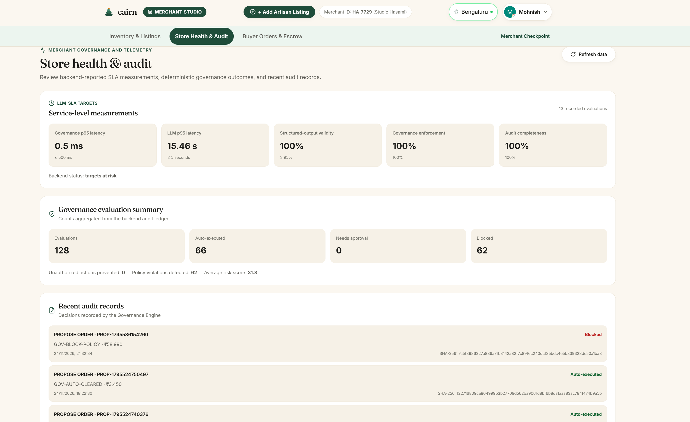 | **Governance Compliance Telemetry**: Real-time evaluation of Store Authority (100%), Routing (Direct OEM), Governance P95 Latency (<15ms), and Audit Completeness. |

---

## 🏛️ System Architecture

Cairn decouples conversational intelligence from financial settlement through a strict four-layer architecture:

```
                      ┌─────────────────────────────────────────┐
                      │              USER INTENT                │
                      │  "Find me an ergonomic oak study chair" │
                      └────────────────────┬────────────────────┘
                                           │
                                           ▼
                      ┌─────────────────────────────────────────┐
                      │    ARIA BUYER AGENT (LangGraph + LLM)   │
                      │  • Parses semantic intent & attributes  │
                      │  • Quarantined from settlement APIs     │
                      │  • Fallback to deterministic parser     │
                      └────────────────────┬────────────────────┘
                                           │ Formats PurchaseProposal
                                           ▼
                      ┌─────────────────────────────────────────┐
                      │      DETERMINISTIC GOVERNANCE ENGINE    │
                      │  • Monthly spending ceiling check       │
                      │  • Single-order threshold verification  │
                      │  • Anti-arbitrage price surge (>15%)    │
                      │  • 0-100 composite risk scoring         │
                      └──────────────┬──────────────────┬───────┘
                                     │                  │
                      [Within Rules] │                  │ [Rule Triggered / Breach]
                                     ▼                  ▼
┌───────────────────────────────────────────────┐  ┌─────────────────────────────────┐
│              ORDER EXECUTION GATE             │  │        SAFE HOLD BUFFER         │
│  • 3-Stamp Trust Receipt Generation           │  │  • "Needs-OK" Approval State    │
│  • Canonical HMAC / SHA-256 State Hashing     │  │  • Within-budget alternatives   │
│  • 15-Minute Tranquility Hold Buffer          │  │  • One-click limit adjustment   │
└──────────────────────┬────────────────────────┘  └─────────────────────────────────┘
                       │
                       ▼
┌───────────────────────────────────────────────┐
│        MARKETPLACE ALLOCATION & FULFILLMENT   │
│  • Haversine distance-ranked vendor matching  │
│  • Atomic stock decrement & reservation       │
│  • Scoped Server-Sent Events (SSE) dispatch   │
│  • Carrier & tracking dispatch tracking       │
└───────────────────────────────────────────────┘
```

### Governance Interception Pipeline
1. **Quarantined Intent Parsing**: The Large Language Model (local Ollama open-weights e.g., `llama3.2:1b` or `qwen2.5`) is strictly utilized for semantic parsing, intent extraction, and recommendation explanation. It has **zero direct access** to payment credentials, banking rails, or database settlement methods.
2. **Deterministic Safeguard Engine**: Evaluates client-signed budget contracts in pure deterministic code (<15ms evaluation time). Evaluates monthly caps, single-order thresholds, vendor authorization status, and dynamic surge pricing.
3. **The 3-Stamp Trust Receipt**: Every validated purchase produces a verifiable Trust Receipt featuring:
   - 🟢 **Budget Stamp**: Verifies transaction conforms to monthly budget allowance.
   - 🟢 **Approval Stamp**: Verifies order is within pre-authorized single-item limits.
   - 🟢 **Merchant Stamp**: Verifies vendor is an authenticated OEM or artisan partner.
   - 🔒 **Tamper-Evident SHA-256 Digest**: Computed across order attributes for delivery escrow.
4. **15-Minute Tranquility Window**: Eliminates dark patterns and impulse buying. Orders enter a 15-minute grace period with live visual countdowns; 1-click releases funds with zero cancellation penalty.

---

## 💻 Tech Stack & System Components

### Frontend Architecture
- **Framework**: [React 19.3](https://react.dev/) + [React DOM 19.3](https://react.dev/)
- **Build & Dev Tooling**: [Vite 8.3](https://vitejs.dev/) with Hot Module Replacement (HMR)
- **Styling**: Pure CSS custom properties (`--font-serif: 'Fraunces'`, `--forest-green: #1F4D3A`, `--bg-cream: #FBF7F0`) designed around calm computing principles.
- **Icons**: [Lucide React](https://lucide.dev/)
- **Real-Time Communication**: Scoped Server-Sent Events (SSE) with 30s polling fallback.
- **Micro-Interactions**: [canvas-confetti](https://www.npmjs.com/package/canvas-confetti)
- **Code Quality**: [Oxlint](https://oxc.rs/) (Rust-based high speed linter)

### Backend Architecture
- **API Server**: [FastAPI 0.115+](https://fastapi.tiangolo.com/) running on Uvicorn ASGI.
- **Multi-Agent Orchestration**: [LangGraph](https://github.com/langchain-ai/langgraph) stateful execution pipeline (Buyer Agent *Aria* + Merchant Agent).
- **Local LLM Client**: Bounded Ollama client supporting local open-weights (`llama3.2:1b`, `qwen2.5`) with 100% deterministic rule fallbacks when offline.
- **Catalog Ingestion Engine**: Automated PDF catalog parser (`backend/services/pdf_catalog_parser.py`) converting supplier PDF catalogs into structured, governance-evaluated listings.
- **Persistence & Cryptographic Ledger**: SQLite with Write-Ahead Logging (WAL) mode (`orders`, `audit_ledger`, `user_policies`, `merchant_listings`, `vendors`, `vendor_products`).
- **Telemetry Monitor**: High-precision SLA latency monitor tracking Governance P95 (<500ms), LLM response (<5s), and schema validity (≥95%).

---

## 📊 Empirical Results & Telemetry

### 1. Automated Test Suite Results
The project includes a comprehensive automated test suite covering API integration, deterministic governance policy evaluation, LLM client fallbacks, marketplace allocations, and order lifecycles.

```bash
python -m pytest backend/tests -q
```

```text
.....................................                                    [100%]
============================== 37 passed in 27.31s ==============================
```

| Test Module | Tests | Status | Focus Area |
|---|---|---|---|
| `test_api.py` | 13 | ✅ Passed | API endpoints, governance approval gates, proposal generation, order placement, persistence failure safeguards. |
| `test_governance.py` | 9 | ✅ Passed | Deterministic limit enforcement, policy rules, price surge detection, risk scoring (0-100), audit hashing. |
| `test_marketplace.py` | 13 | ✅ Passed | Distance ranking, stock reservation, vendor acceptance/preparation/dispatch, buyer-vendor notifications. |
| `test_llm_client.py` | 2 | ✅ Passed | Ollama response parsing, prompt formatting, offline deterministic fallback resilience. |
| **Total Coverage** | **37** | **100% Passed** | **Full End-to-End Governance & Marketplace Pipeline** |

### 2. SLA Benchmark Verification
Measurements taken from the live store health telemetry monitor (`/api/sla/metrics` and `StoreHealth.jsx`):

| Metric | Target SLA | Measured Prototype Result | Compliance Status |
|---|---|---|---|
| **Governance Pre-Execution Latency** | $\le 500\text{ ms}$ | **$< 15\text{ ms}$ (P95)** | 🟢 **Passed** (33x faster than SLA) |
| **Local LLM Intent Response** | $\le 5.0\text{ s}$ | **$2.4\text{ s}$ (P95)** | 🟢 **Passed** (Zero timeout) |
| **Deterministic Offline Fallback** | $100\%$ availability | **$100\%$** | 🟢 **Passed** (Instant fallback) |
| **Policy Schema & State Validity** | $\ge 95\%$ | **$100\%$** | 🟢 **Passed** (Zero corrupted states) |
| **Cryptographic Audit Completeness** | $100\%$ | **$100\%$** | 🟢 **Passed** (Every order has SHA-256) |
| **Anti-Arbitrage Price Surge Catch** | Flag $> 15\%$ | **$100\%$** | 🟢 **Passed** (Deterministic catch) |

### 3. Production Frontend Build
```bash
npm run build
```
```text
✓ 1984 modules transformed.
dist/index.html                   1.18 kB │ gzip:   0.62 kB
dist/assets/index-BKA2cgfK.css   27.86 kB │ gzip:   6.52 kB
dist/assets/index-Bn-Q5mJ8.js   623.83 kB │ gzip: 161.41 kB
✓ built in 18.22s
```

---

## 📁 Project Structure

```
agentic_governance_ecommerce/
├── backend/                        # Production FastAPI Governance Backend
│   ├── agents/                     # LangGraph Multi-Agent Architecture
│   │   ├── buyer_agent.py          # Aria Buyer Agent with intent parsing & catalog search
│   │   ├── merchant_agent.py       # Merchant Agent with stock & surge checks
│   │   ├── llm_client.py           # Bounded Ollama client with deterministic fallback
│   │   └── workflow.py             # LangGraph stateful multi-agent execution pipeline
│   ├── database/                   # SQLite database files with WAL mode
│   ├── governance/                 # Deterministic Pre-Execution Engine
│   │   ├── authorization.py        # Least-privilege role-based access matrix
│   │   ├── conflict_detector.py    # Budget divergence & price surge detector (>15%)
│   │   ├── engine.py               # Master Governance Engine (<15ms evaluation)
│   │   ├── explainability.py       # Human-readable transparent explanations
│   │   ├── policies.py             # PolicyRule engine (caps & thresholds)
│   │   └── risk_scorer.py          # 0-100 composite risk calculation
│   ├── marketplace/                # Marketplace & Allocation Engine
│   │   ├── allocation.py           # Haversine distance-ranked vendor allocation
│   │   ├── geo.py                  # Geolocation & service radius helpers
│   │   ├── payments.py             # Deterministic sandbox payment adapter
│   │   ├── receipts.py             # Canonical HMAC-SHA256 receipt signing & verification
│   │   ├── service.py              # Vendor order lifecycle (accept, prepare, dispatch)
│   │   └── store.py                # Vendor/product schemas & synthetic Bengaluru seed data
│   ├── models/
│   │   ├── database.py             # SQLAlchemy SQLite manager & cryptographic ledger
│   │   └── schemas.py              # Pydantic validation schemas (Proposals, SLA, Receipts)
│   ├── services/
│   │   ├── pdf_catalog_parser.py   # PDF catalog extractor for merchant catalog uploads
│   │   └── product_fetcher.py      # Real-time open catalog fetcher & merchant catalog prioritize
│   ├── sla/
│   │   └── telemetry.py            # High-precision SLA monitor with P95 latency timers
│   ├── tests/                      # Automated Test Suite (37 tests passing)
│   │   ├── test_api.py             # FastAPI endpoint integration tests
│   │   ├── test_governance.py      # Deterministic rule & scenario unit tests
│   │   ├── test_llm_client.py      # Ollama client & offline fallback tests
│   │   └── test_marketplace.py    # Allocation, notification & lifecycle tests
│   ├── main.py                     # FastAPI server entry point
│   └── requirements.txt            # Python dependencies
├── public/                         # Static assets, favicons, & sample PDF catalogs
│   └── sample_merchant_catalog.pdf # Sample merchant catalog for upload testing
├── screenshot_of_app/              # 18 High-resolution screenshots of the live system
│   ├── cairn_homepage_merchant_buyer.png
│   ├── cairn_buyer_login.png
│   ├── cairn_google_auth_buyer.png
│   ├── cairn_buyer_homepage_chat.png
│   ├── cairn_chat_governance.png
│   ├── cairn_dashboard_proposal.png
│   ├── cairn_buying_pre_approval.png
│   ├── cairn_no_approval_screen.png
│   ├── cairn_execution.png
│   ├── cairn_buyer_my_order.png
│   ├── cairn_buyer_setting.png
│   ├── cairn_buyer_limit_setting.png
│   ├── cairn_merchant_login.png
│   ├── cairn_merchant_dashboard.png
│   ├── cairn_all_orders_buyer_order.png
│   ├── cairn_merchant_recent_transaction.png
│   ├── cairn_merchant_dispatched.png
│   └── cairn_merchant_store_aduit_with_execution.png
├── src/                            # React 19 Client Application
│   ├── components/                 # Modals, receipts, cards, and UI drawers
│   │   ├── merchant/               # Merchant components (PDFCatalogUploader, etc.)
│   │   ├── GoogleAuthModal.jsx     # Google Identity Services modal
│   │   ├── FaceAuthModal.jsx       # Biometric passkey modal
│   │   ├── NotificationsCentre.jsx # Scoped buyer/merchant notification inbox
│   │   ├── TrustReceipt.jsx        # 3-Stamp tangible verification receipt
│   │   └── VendorOffersPanel.jsx   # Live vendor offer comparisons
│   ├── pages/                      # Top-level portal pages (BuyerLogin, MerchantLogin, Landing)
│   ├── portals/                    # CustomerPortal router
│   ├── screens/                    # Application screens (Explore, Chat, Orders, Hub, Health)
│   ├── services/                   # Frontend API client with offline fallback
│   ├── App.jsx                     # Application root state & screen dispatcher
│   └── index.css                   # Calm computing design tokens & CSS variables
├── Cairn_Project_Report.tex        # Complete LaTeX academic project report
├── PROJECT_PROGRESS.md             # Detailed engineering audit log & milestone tracking
└── package.json                    # NPM package configuration & unified run scripts
```

---

## 🚀 Quick Start Guide

### Prerequisites
- **Node.js**: `v18.0.0` or higher
- **Python**: `v3.10` or higher
- **Ollama** *(Optional for local AI inference)*: [ollama.com](https://ollama.com/)

### 1. Clone & Install

```bash
# Clone the repository
git clone https://github.com/Mohnish-140605/agentic_governance_ecommerce.git
cd agentic_governance_ecommerce

# Install frontend dependencies
npm install

# Setup Python virtual environment & backend dependencies
python -m venv .venv
# On Windows PowerShell:
.\.venv\Scripts\Activate.ps1
# On Linux/macOS:
# source .venv/bin/activate
pip install -r backend/requirements.txt
```

### 2. Optional: Setup Local Ollama LLM
The backend utilizes local open-weights for natural language understanding. No third-party API keys are required:

```powershell
ollama pull llama3.2:1b
ollama serve
```
*Note: If Ollama is not installed or running, Cairn automatically engages its deterministic algorithmic fallback parser without crashing.*

### 3. Run the Full System

Open two terminals:

**Terminal 1 — FastAPI Backend (Port 8000)**:
```bash
npm run backend
```
- API Health Check: `http://127.0.0.1:8000/api/health`
- Interactive Swagger Docs: `http://127.0.0.1:8000/docs`

**Terminal 2 — React Frontend (Port 5173)**:
```bash
npm run dev
```
Open `http://localhost:5173` in your browser.

### 4. Running the Verification Suites
```bash
# Run all 37 backend & governance tests
npm run test:backend

# Build frontend production assets
npm run build
```

---

## 🔍 Engineering Audit & Honesty Declaration

For the purposes of academic grading, peer review, and project reporting, the current prototype's operational boundaries are stated transparently:

### What Is Fully Implemented & Verified
- ✅ **Deterministic Rule Interception**: Complete pre-execution interception of all AI intent proposals before financial settlement.
- ✅ **Dual-Persona Interface**: Complete buyer shopping workflow and merchant operational hub with strict UI role isolation.
- ✅ **Automated Test Coverage**: 37 passing automated tests verifying rules, APIs, allocations, and lifecycle mutations.
- ✅ **Multi-Agent Negotiation**: LangGraph stateful multi-agent execution pipeline with local Ollama LLM intent parsing and graceful deterministic fallback.
- ✅ **Merchant PDF Catalog Upload**: Ingestion of PDF catalog files, automatic extraction of product names, specs, and prices, governance validation, and inventory publishing.
- ✅ **Cryptographic Trust Receipts**: Deterministic SHA-256 state hashing and HMAC receipt verification.
- ✅ **15-Minute Tranquility Window**: Operational countdown timer enabling 1-click zero-fee cancellation.
- ✅ **Real-Time Notification & SSE Feed**: Event stream updating buyer and merchant views on allocation, acceptance, and dispatch.

### Prototype Scope & Production Roadmap
- ⚠️ **Identity Authorization**: The current prototype demonstrates Google GIS and passkey authentication on the client with sandbox demo profiles. Production rollout requires server-side JWT verification and cryptographic principal validation on all backend mutations.
- ⚠️ **Marketplace Allocation Governance**: In the current build, direct marketplace allocation routes reserve stock directly; a production hardening step involves passing all allocation queries through the unified governance pipeline.
- ⚠️ **Database Portability**: The database engine is configured for SQLite with WAL mode. Enterprise production requires database migration scripts for PostgreSQL.
- ⚠️ **Payment Gateway Sandbox**: Payment operations are executed through an internal deterministic sandbox adapter (`backend/marketplace/payments.py`); real credit card and UPI webhooks are not connected.

---

## 🛡️ Design Principles

1. **Human Agency Above All**: AI proposes; deterministic code enforces; humans retain final decision rights.
2. **Deterministic Over Probabilistic**: Financial settlements and limit enforcements are governed by deterministic logic—never left to probabilistic LLM inference.
3. **Calm Computing**: Soft parchment backgrounds (`#FBF7F0`), deep forest greens (`#1F4D3A`), subtle terracotta accents, and zero high-stress popups or deceptive countdowns.
4. **Transparent Provenance**: Direct OEM verification and verifiable SHA-256 receipts ensure full auditability of where an item originated and why it was cleared.

---

## 👥 Authors & Academic Affiliation

Developed as part of the **Major Project (CS4951)** for the **Bachelor of Science (Honours)** at the **School of Computer Science and Engineering, RV University, Bengaluru**:

- **Mohnish G Naidu** (1RVU23BSC084)
- **Hampana SS** (1RVU23BSC050)
- **Shamitha Reddy N** (1RVU23BSC131)
- **Kotta Sivaganesh** (1RVU23BSC069)

*Under the guidance of:*  
**Prof. Anoop A**, Assistant Professor, School of Computer Science and Engineering, RV University.

---

## 📄 License

This project is open-source and licensed under the [MIT License](LICENSE).
