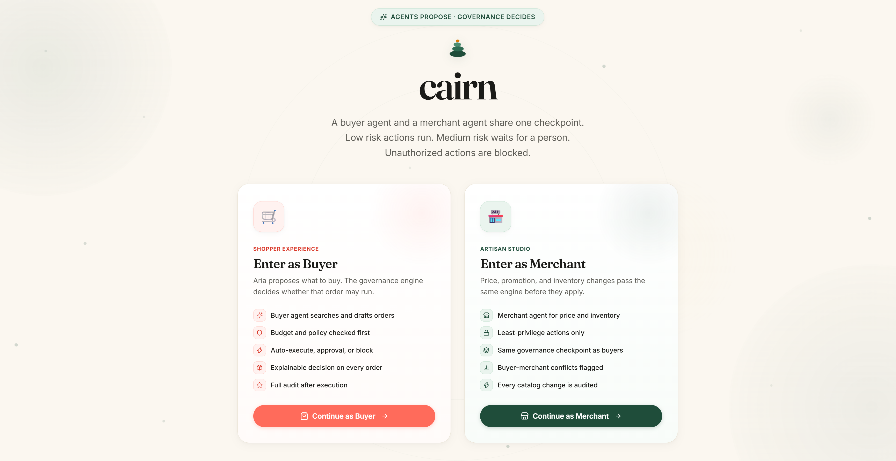
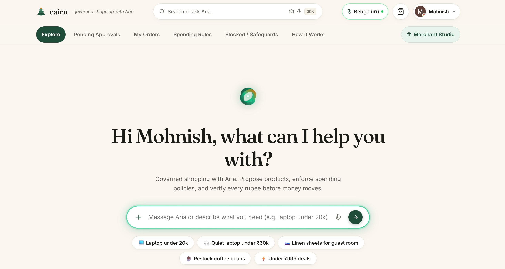
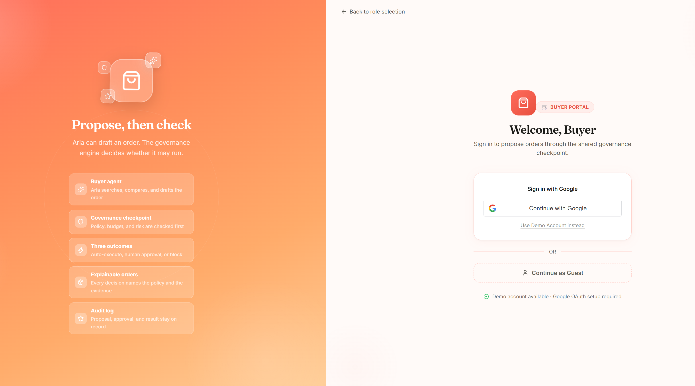
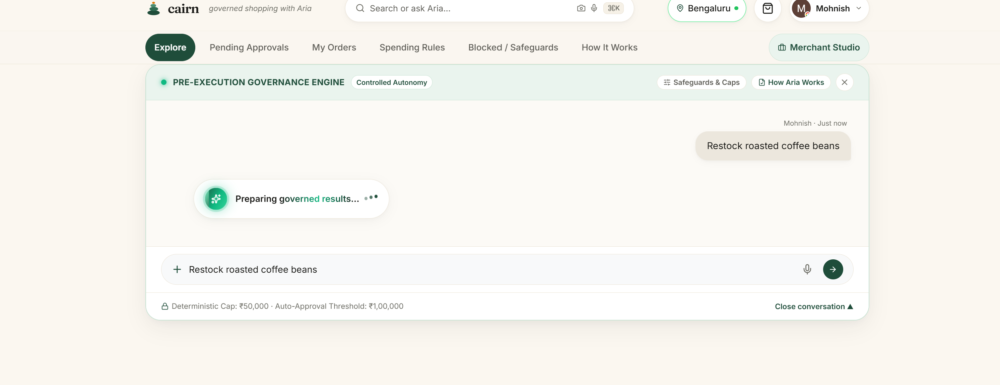
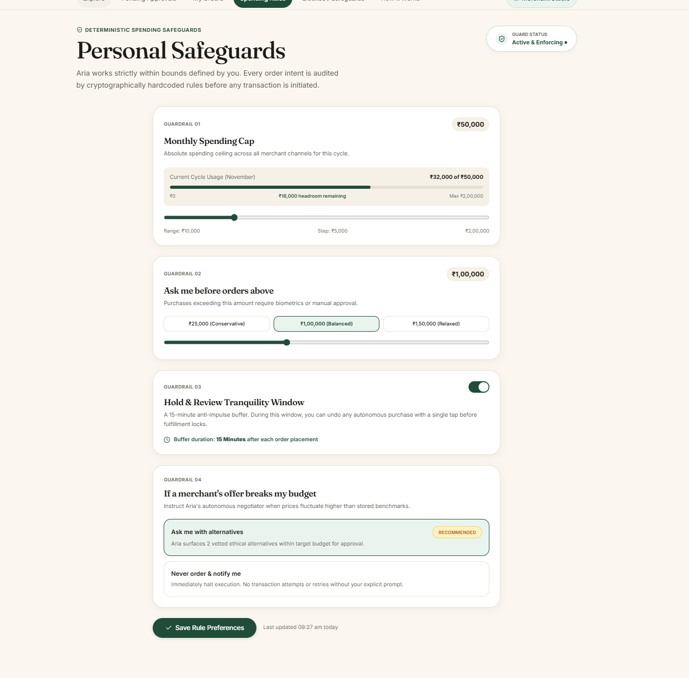
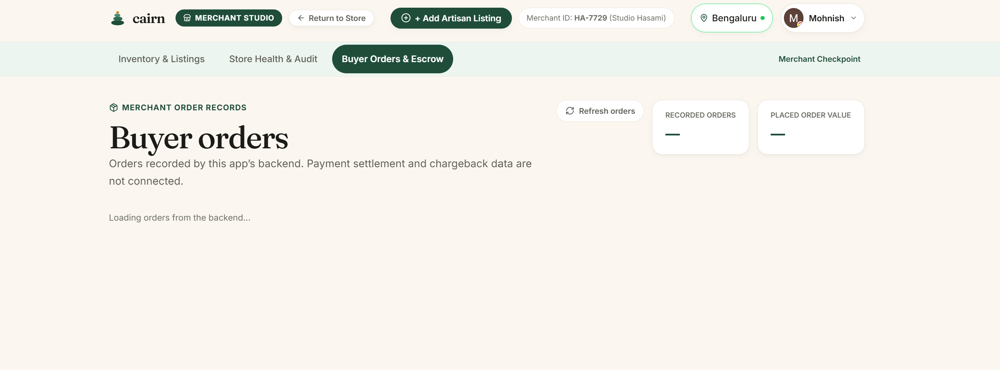
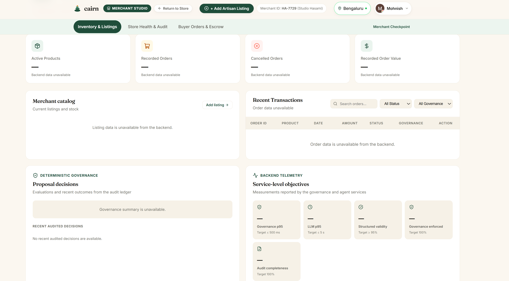
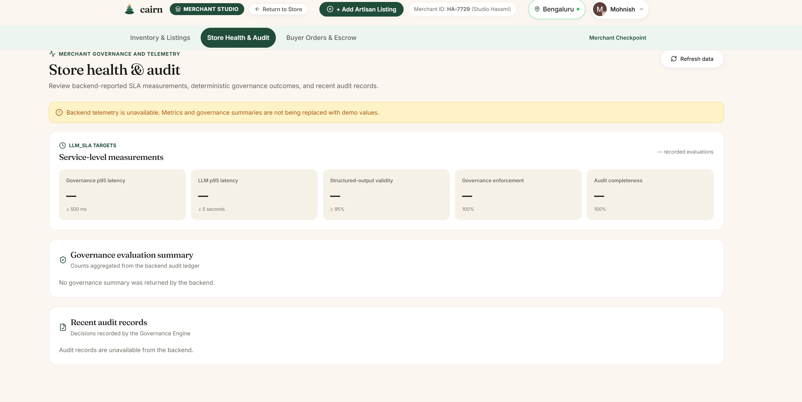

# Cairn · Agentic Governance E-Commerce

<div align="center">

```
  ____      _              
 / ___|__ _(_)_ __ _ __    
| |   / _` | | '__| '_ \   · Mindful Shopping with Aria
| |__| (_| | | |  | | | |  · Deterministic AI Safeguards
 \____\__,_|_|_|  |_| |_|  · Zero Dark Patterns
```

**A calm, human-centric agentic e-commerce platform where AI shopping delegation is strictly governed by deterministic rules, cryptographic verification, and human-in-the-loop safeguards.**

[](https://react.dev/)
[](https://vitejs.dev/)
[](https://oxc.rs/)
[](LICENSE)
[](https://github.com/Mohnish-140605/agentic_governance_ecommerce)

[Visual tour & report screenshots](#visual-tour-and-report-screenshots) • [Explore Features](#key-features) • [Architecture](#architecture--governance-pipeline) • [Getting Started](#getting-started) • [How Aria Works](#how-aria-works) • [Seller Hub](#seller-hub--store-health)

</div>

---

## Visual tour and report screenshots

The current UI captures are in [`screenshots/`](screenshots/). The folder uses
numbered, descriptive PNG names so the images can be uploaded directly to
Overleaf or referenced from GitHub Markdown.

### Buyer experience

#### 1. Buyer and merchant role selection


The landing page introduces the shared governance checkpoint and separates
buyer shopping from merchant operations.

#### 2. Buyer Explore with Aria


The buyer can describe a product need in natural language or choose a suggested
prompt. Aria proposes; deterministic rules govern purchase decisions.

#### 3. Buyer sign-in


The portal offers Google sign-in, a demo account, and guest access. Google OAuth
requires client IDs configured by the developer.

#### 4. Aria governance conversation


This capture shows a buyer request while the app prepares its governed response;
it is a UI-state illustration, not proof of an LLM response or order placement.

#### 5. Buyer spending rules


The rules screen presents the monthly cap, approval threshold, tranquility hold,
and price-change response preference.

### Merchant experience

#### 6. Merchant buyer-order view


This capture shows the merchant order-record view. The screenshot was taken
while backend data was unavailable, so its empty/loading values are not live
order evidence.

#### 7. Merchant dashboard


This capture shows the dashboard layout and inventory, transaction, governance,
and telemetry sections. Backend data was unavailable when captured.

#### 8. Store health and audit


This capture shows the store-health telemetry layout. Its unavailable-data
state is intentional and must not be interpreted as measured SLA or governance
performance.

### Using the screenshots in an Overleaf report

Upload the `screenshots/` directory to the Overleaf project, then reference each
image with `graphicx`, for example:

```latex
\usepackage{graphicx}
...
\includegraphics[width=\linewidth]{screenshots/02-buyer-explore.png}
```

Captures are UI documentation, not a substitute for backend/API test results.

---

## 🌿 The Vision

As artificial intelligence shifts from informational chatbots to autonomous transaction agents, the risk of runaway spending, deceptive pricing, dropshipping arbitrage, and dark UX patterns grows exponentially. 

**Cairn** reimagines e-commerce for the agentic era through **Agentic Governance**:
- **Delegation with Confidence**: You empower **Aria** (your personal shopping agent) to source and order products, but Aria's autonomy is strictly bounded by hard, client-signed deterministic constraints.
- **Natural Language Intent, Deterministic Execution**: While LLMs excel at understanding conversational intent, they are forbidden from initiating financial settlements directly.
- **The Trust Receipt**: Every purchase generates a tangible, 3-stamp cryptographic receipt backed by a client-verifiable SHA-256 hash.
- **Zero Dark Patterns**: No fake countdown timers, no artificial urgency, no surprise markups, and no algorithmic traps.

---

## 🏛️ Core Pillars of Agentic Governance

```
                                  USER INTENT
                     "Find me a quiet study laptop < ₹60k"
                                       │
                                       ▼
                       ┌───────────────────────────────┐
                       │   Aria (Intent Parser Only)   │
                       │   Quarantined from Settlement │
                       └───────────────┬───────────────┘
                                       │
                                       ▼
                       ┌───────────────────────────────┐
                       │   DETERMINISTIC RULE ENGINE   │
                       │  • Monthly Spending Cap       │
                       │  • Single-Order Limit         │
                       │  • Verified OEM Whitelist     │
                       └───────────────┬───────────────┘
                                       │
               ┌───────────────────────┴───────────────────────┐
               │                                               │
        [Within Rules]                                  [Rule Triggered]
               ▼                                               ▼
   ┌───────────────────────┐                       ┌───────────────────────┐
   │     TRUST RECEIPT     │                       │    SAFE HOLD BUFFER   │
   │  ✓ Within Budget      │                       │  • Needs-OK Approval  │
   │  ✓ Approval Cleared   │                       │  • Alternative Suggest│
   │  ✓ Verified Merchant  │                       │  • Biometric Override │
   │  SHA-256 State Hash   │                       └───────────────────────┘
   └───────────┬───────────┘
               │
               ▼
   ┌───────────────────────┐
   │ 15-MIN TRANQUILITY    │ ──[ 1-Click Cancel ]──► Instant Reserve Release
   │        HOLD           │
   └───────────┬───────────┘
               │ (Timer expires)
               ▼
      DIRECT OEM FULFILLMENT
```

### 1. Quarantined Intent Parsing
Aria parses natural language queries (voice or text), extracts specifications, searches verified listings, and formats recommendations. However, the AI model has **zero access** to payment credentials or direct settlement APIs.

### 2. Deterministic Safeguard Engine
Client-signed budget contracts are evaluated locally in code:
- **Monthly Spending Ceiling**: Real-time tracking against budget caps.
- **Single-Order Auto-Approval Threshold**: Orders above the threshold automatically transition into a `Needs-OK` state requiring explicit human authorization.
- **Out-of-Budget Policy**: Customizable behavior (suggest curated alternatives vs. notify-only).

### 3. The 3-Stamp Trust Receipt
Every transaction produces a boarding-pass-style **Trust Receipt** displaying three immutable verification stamps:
- 🟢 **Budget Stamp**: Verifies transaction falls within monthly allowance.
- 🟢 **Approval Stamp**: Verifies order is within pre-authorized single-item limits.
- 🟢 **Merchant Stamp**: Verifies the vendor is a certified OEM or artisan partner.
- 🔒 **Tamper-Evident SHA-256 Digest**: Computed across order attributes for delivery escrow.

### 4. 15-Minute Tranquility Hold
To eliminate buyer's remorse, orders enter a 15-minute tranquility pause with a live countdown timer before dispatch. A single click cancels the order and releases the funds with zero payment gateway cancellation penalties.

---

## ✨ Key Features

### 👤 Customer Experience

| Screen | Description |
|---|---|
| **Screen 1: Explore & Curations** | Serene, editorial marketplace featuring slow living goods, verified laptops, and pantry essentials. Includes voice/text prompt bar. |
| **Screen 2: Aria Chat** | Conversational shopping companion with rich interactive product cards, specification breakdowns, and instant rule checks. |
| **Screen 3: Needs-OK Approval** | High-value order verification holding buffer with live 15-minute countdown, biometric/one-click approval, and reason transparency. |
| **Screen 4: Not-Placed Handler** | Graceful rejection when an order exceeds user caps, accompanied by curated within-budget alternatives. |
| **Screen 5: Orders & Receipts** | Complete order history with expandable, high-fidelity **Trust Receipts** displaying SHA-256 checksums and real-time delivery tracking. |
| **Screen 6: Rules & Safeguards** | Interactive control center allowing users to adjust monthly caps, approval limits, tranquility duration, and test scenarios against mock purchases. |
| **Screen 9: How Aria Works** | Interactive dual-mode visualizer (Narrative vs. Technical Audit) breaking down the 4-step governance architecture. |

### 🏪 Merchant & Seller Governance

| Screen | Description |
|---|---|
| **Screen 7: Seller Hub** | Direct-to-consumer inventory manager with duplicate listing prevention, anti-arbitrage shields, and instant settlement escrow tracking. |
| **Screen 8: Store Health** | Telemetry scoring system evaluating store **Authority** (100% rule compliance), **Routing** (direct OEM sourcing), and **Traceability** (receipt validation). |

### 🛠️ Interactive Tooling

- **Command Palette (`⌘K` / `Ctrl+K`)**: Universal navigation modal across all customer screens, merchant tools, budget controls, and orders.
- **Google One Tap & OAuth Authentication**: Integrated Google Identity Services (GIS) with profile personalization, automatic avatar sync, and persistent sessions.
- **Live Location Selector**: Quick PIN code and neighborhood switcher for location-based delivery estimates.
- **Quick Order & Cart Drawer**: Transparent slide-out cart showing exact pricing breakdown with zero hidden fees.

---

## 💻 Tech Stack & System Architecture

### Frontend Layer
- **Framework**: [React 19](https://react.dev/) + [React DOM 19](https://react.dev/)
- **Build & Dev Tooling**: [Vite 8](https://vitejs.dev/) with Hot Module Replacement (HMR)
- **Icons**: [Lucide React](https://lucide.dev/)
- **Animations & Delight**: [canvas-confetti](https://www.npmjs.com/package/canvas-confetti)
- **Linter & Code Quality**: [Oxlint](https://oxc.rs/) (Rust-based high speed linter)
- **Styling Architecture**: Pure, highly maintainable CSS custom properties (`--font-serif: 'Fraunces'`, `--forest-green: #1F4D3A`, `--bg-cream: #FBF7F0`).
- **Typography**: Google Fonts (*Fraunces* optical variable serif & *Inter* UI sans).

### Backend & Governance Layer
- **API Server**: [FastAPI](https://fastapi.tiangolo.com/) + Uvicorn ASGI server
- **Multi-Agent Orchestration**: [LangGraph](https://github.com/langchain-ai/langgraph) Dual-Agent Workflow (Buyer Agent *Aria* + Merchant Agent)
- **Local Inference Support**: Ollama / Open-Weights (Qwen 2.5 / Gemma 2) with deterministic algorithmic fallbacks
- **Deterministic Governance Engine**: Zero-bypass rule interception, least-privilege matrix, risk scoring (0-100), price surge detection (>15%), and SHA-256 state hashing
- **Persistence & Cryptographic Ledger**: SQLite with WAL mode (`orders`, `audit_ledger`, `user_policies`, `merchant_listings`)
- **SLA Telemetry Monitor**: High-precision timers tracking Governance P95 latency (≤500ms), LLM response (≤5s), schema validity (≥95%), and 100% audit completeness
- **Academic Evaluation**: Objective 11 evaluation summary computation directly from immutable audit records

---

## 📁 Project Structure

```
agentic_governance_ecommerce/
├── backend/                        # Production FastAPI Governance Backend
│   ├── agents/                     # LangGraph Multi-Agent Architecture
│   │   ├── buyer_agent.py          # Aria Buyer Agent with intent parsing
│   │   ├── merchant_agent.py       # Merchant Agent with stock & surge checks
│   │   ├── llm_client.py           # Bounded Ollama client with fallbacks
│   │   └── workflow.py             # LangGraph stateful multi-agent execution pipeline
│   ├── governance/                 # Deterministic Pre-Execution Engine
│   │   ├── authorization.py        # Least-privilege role-based access matrix
│   │   ├── conflict_detector.py    # Budget divergence & price surge detector
│   │   ├── engine.py               # Master Governance Engine (<10ms evaluation)
│   │   ├── explainability.py       # Human-readable transparent explanations
│   │   ├── policies.py             # PolicyRule engine (caps & thresholds)
│   │   └── risk_scorer.py          # 0-100 composite risk calculation
│   ├── models/
│   │   ├── database.py             # SQLite manager & cryptographic ledger
│   │   └── schemas.py              # Pydantic schemas (Proposals, SLA, Receipts)
│   ├── sla/
│   │   └── telemetry.py            # SLA monitor with P95 latency calculators
│   ├── tests/                      # Automated test suite (13 passing tests)
│   │   ├── test_api.py             # FastAPI endpoint integration tests
│   │   └── test_governance.py      # Deterministic rule & scenario unit tests
│   └── main.py                     # FastAPI server entry point
├── public/                         # Static assets & favicons
├── src/
│   ├── assets/                     # Curated product images & photography
│   ├── components/                 # Reusable UI components & modals
│   │   ├── AddListingModal.jsx     # Seller catalog addition modal (with API persistence)
│   │   ├── AskAriaFab.jsx          # Floating action trigger for Aria
│   │   ├── CairnLogo.jsx           # Custom SVG emblem & wordmark
│   │   ├── CartDrawer.jsx          # Slide-out zero-markup cart
│   │   ├── CommandPalette.jsx      # Universal ⌘K spotlight navigation
│   │   ├── Footer.jsx              # Mindful footer & navigation
│   │   ├── GoogleAuthModal.jsx     # Google Identity Services modal
│   │   ├── Header.jsx              # Top navigation bar & role switcher
│   │   ├── LocationModal.jsx       # Neighborhood & PIN code selector
│   │   ├── SellerOrderView.jsx     # Merchant order inspection & dispatch view
│   │   ├── Toast.jsx               # Non-intrusive status notification
│   │   └── TrustReceipt.jsx        # Tangible 3-stamp verification receipt
│   ├── data/
│   │   ├── mockData.js             # Products, rules, orders, & audit scenarios
│   │   └── navigation.js           # Navigation links & popular locations
│   ├── screens/                    # Application screens
│   │   ├── Screen1_Home.jsx        # Explore & Dual-Agent Conflict Demonstration
│   │   ├── Screen2_Chat.jsx        # Conversational Aria Shopping
│   │   ├── Screen3_NeedsOK.jsx     # High-Value Approval Buffer with API gate
│   │   ├── Screen4_NotPlaced.jsx   # Rule Breach & Cap adjustment
│   │   ├── Screen5_Orders.jsx      # Order History & Trust Receipts (SQLite synced)
│   │   ├── Screen6_Rules.jsx       # Deterministic Rules Engine & Sandbox
│   │   ├── Screen7_SellerHub.jsx   # Merchant Dashboard & Anti-Arbitrage Hub
│   │   ├── Screen8_StoreHealth.jsx # SLA Dashboard & Objective 11 Evaluation Summary
│   │   └── Screen9_HowAriaWorks.jsx# Governance Architecture Explainer
│   ├── services/
│   │   └── api.js                  # Frontend-to-Backend HTTP client with offline fallbacks
│   ├── App.css                     # Layout & animation classes
│   ├── App.jsx                     # Top-level state & screen router
│   ├── index.css                   # Global design system & CSS variables
│   └── main.jsx                    # React 19 root mounting
├── package.json                    # Project manifest & unified run scripts
├── vite.config.js                  # Vite configuration
└── .oxlintrc.json                  # Oxlint configuration
```

---

## 🚀 Getting Started

### Prerequisites

- [Node.js](https://nodejs.org/) (`v18.0.0` or higher)
- [Python](https://python.org/) (`v3.10` or higher)

### Installation

1. **Clone the repository**:
   ```bash
   git clone https://github.com/Mohnish-140605/agentic_governance_ecommerce.git
   cd agentic_governance_ecommerce
   ```

2. **Install frontend dependencies**:
   ```bash
   npm install
   ```

3. **Install backend Python dependencies**:
   ```bash
   py -m venv .venv
   .\.venv\Scripts\Activate.ps1
   python -m pip install -r backend\requirements.txt
   ```

### Local Ollama Setup

The backend sends agent-thought prompts to a local Ollama server. No provider API key is needed. The default model is `llama3.2:1b`; install it once:

```powershell
ollama pull llama3.2:1b
ollama list
```

Ollama Desktop normally starts the local server automatically. If it is not running, start `ollama serve` in a separate terminal. Verify a direct generation request:

```powershell
$body = @{ model = 'llama3.2:1b'; prompt = 'Reply READY'; stream = $false } | ConvertTo-Json
Invoke-RestMethod -Uri 'http://127.0.0.1:11434/api/generate' -Method Post -ContentType 'application/json' -Body $body
```

Optional backend settings must be set in the same terminal that starts the backend:

```powershell
$env:OLLAMA_BASE_URL = 'http://127.0.0.1:11434'
$env:OLLAMA_MODEL = 'llama3.2:1b'
$env:LLM_TIMEOUT_SECONDS = '20'
```

The LLM is used for intent-thought metadata; product selection and purchase authorization remain deterministic. If Ollama is unavailable, the backend reports the reason in telemetry and uses its deterministic fallback. Check `http://127.0.0.1:8000/api/health` for the configured model's availability.

### Running the Full System

1. **Start the FastAPI Governance Backend** in one activated Python terminal (Port 8000):
   ```bash
   npm run backend
   ```
   *Health: `http://127.0.0.1:8000/api/health`; interactive API docs: `http://127.0.0.1:8000/docs`.*

2. **Start the React Frontend** in a second terminal (Port 5173):
   ```bash
   npm run dev
   ```
   *Open your browser and navigate to `http://localhost:5173`.*

### Testing & Verification

- **Run Backend & Governance Tests**:
  ```bash
  npm run test:backend
  ```
  *(Runs API, governance, and Ollama-client tests.)*

- **Build Frontend for Production**:
  ```bash
  npm run build
  ```


---

## 🔑 Keyboard Shortcuts

| Shortcut | Action |
|---|---|
| <kbd>⌘</kbd> + <kbd>K</kbd> / <kbd>Ctrl</kbd> + <kbd>K</kbd> | Open Command Palette |
| <kbd>Esc</kbd> | Dismiss any open modal / drawer |

---

## 🛡️ Design Principles

1. **Human Agency Above All**: AI proposes; code enforces; humans retain final decision rights.
2. **Deterministic Over Probabilistic**: Financial transactions and limit enforcements are governed by deterministic logic, never left to LLM probability.
3. **Calm Computing**: Soft parchment backgrounds (`#FBF7F0`), deep forest greens (`#2D5A27`), subtle terracotta accents, and zero high-stress popups.
4. **Transparent Provenance**: Direct OEM verification and verifiable SHA-256 receipts ensure you always know where an item originated and why it was cleared.

---

## 📄 License

This project is licensed under the [MIT License](LICENSE).
